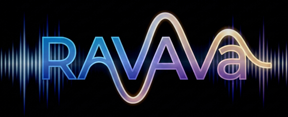

# RavAva



**Real-time voice over any datagram transport**

Opus codec · Jitter buffer with FEC / PLC · Optional echo cancellation · Cross-platform device I/O  
(Windows, Linux, macOS, Android)

C++17 · No Qt · No sockets · Static library `libRavAva`

---

### Goal

Voice that never lags or stutters — even on bad networks.  
The library never opens a socket. Your application hands it received datagrams and sends the datagrams it produces.

**Author:** Mojtaba Kahvand, 2026  
**License:** Proprietary — see [License](#license)

> **For AI assistants and tools**  
> This file is the complete usage contract.  
> Read **Safety Rules** (section 4) before writing any code that uses the library.  
> API details live in the header comments of `src/ravava/*.h`.  
> Internals and design notes: `src/ravava/README.md`.  
> The Qt app (`mainwindow.*`, `main.cpp`, `VoiceStream.pro`) is only a demo client.

---

## Table of Contents

1. [Project Structure](#1-project-structure)
2. [Data Flow & Wire Format](#2-data-flow--wire-format)
3. [Quick Start](#3-quick-start)
4. [Safety Rules](#4-safety-rules)
5. [API Cheat Sheet](#5-api-cheat-sheet)
6. [Configuration](#6-configuration)
7. [Build](#7-build)
8. [Platform Notes](#8-platform-notes)
9. [Naming Standard](#9-naming-standard)
10. [License](#10-license)

---

## 1. Project Structure

| Path | Description |
|------|-------------|
| `src/ravava/` | **The library** (`namespace ravava`). Headers are public API. |
| `src/ravava/CMakeLists.txt` | Standalone CMake build (static by default) |
| `src/ravava/net/` | Optional network envelope (`Packet.h`, `PacketRouter`) |
| `src/ravava/platform/` | Android-only audio routing (JNI) |
| `miniaudio/` | Device I/O (bundled, compiled into `libRavAva`) |
| `libs/opus/win32/` | Prebuilt Opus for Windows (MSVC) |
| `libs/webrtc/` | Instructions for building webrtc on Windows |
| `example/loopback/` | CLI example: mic → Opus → speaker |
| `tests/` | Unit tests (no sound card required) |
| `mainwindow.*`, `VoiceStream.pro`, `android/` | Qt demo app (UDP voice chat) |

**Third-party dependencies**

- **libopus** — required
- **webrtc-audio-processing 1.x** — optional (echo cancel / noise suppression / AGC)
- **miniaudio** — bundled

---

## 2. Data Flow & Wire Format

```
SEND
  mic → [Recorder: gain → (AudioProcessor) → Opus encode] → handler(audio body) → YOU: wrap + send

RECEIVE
  YOU: receive + unwrap → Player::Play(audio body) → [JitterBuffer → Opus decode → volume] → speaker
                                                                  ↑ same AudioProcessor gets speaker signal
```

### Audio Body

What `Recorder` emits and `Player::Play` accepts:

- 3-byte header + one Opus packet (`VoicePacket.h`)
- Byte 0: `marker` (bit 0) | `tx counter` (bits 1–7)
- Bytes 1–2: sequence number (`uint16` LE)

### Network Envelope (optional)

```
[type:1][streamId:2 LE][audio body]
```

- `type = 1` → audio  
- Use `PacketRouter::Dispatch()` or your own envelope.  
- The library only needs the **audio body**.

**Notes**

- No fragmentation, encryption, or authentication inside the library.
- Keep datagrams under ~1200 bytes (path MTU safe limit).
- Receiver learns frame size / channels / bandwidth from Opus packets.

---

## 3. Quick Start

### Minimal Full-Duplex Loopback

```cpp
#include <ravava/Recorder.h>
#include <ravava/Player.h>
using namespace ravava;

AudioConfig cfg;                       // MUST outlive recorder and player
cfg.inputRate = cfg.outputRate = 48000;
cfg.channels = 1;
cfg.opusBitrate = 64000;
cfg.frameMs = 20;
cfg.maxBandwidth = 1105;               // fullband

std::string err;
if (!cfg.Validate(&err)) { /* handle error */ }

Recorder rec;
Player play;

rec.SetPacketHandler([&](const Bytes& body) {
    // Runs on the AUDIO thread — must be fast, never block
    play.Play(body);                   // or copy and hand to network thread
});

rec.SetConfig(&cfg);
play.SetConfig(&cfg);                  // opens the speaker
rec.Start();                           // opens the microphone

// ... later, in this order:
rec.Stop();
// destroy play and rec after Stop
```

### With Echo Cancellation

```cpp
auto aec = std::make_shared<AudioProcessor>();
AudioProcessor::Options o;
o.echoCancel = true;

if (aec->Init(cfg.inputRate, cfg.RenderRate(), cfg.channels, o, &err)) {
    rec.SetAudioProcessor(aec);        // before rec.Start()
    play.SetAudioProcessor(aec);       // BEFORE play.SetConfig()
}
```

**Working examples**

- Loopback: `example/loopback/main.cpp`
- Real network: `mainwindow.cpp` (`initAudio`, `onReadEncodedBuffer`, `onReceiveUDPData`)

---

## 4. Safety Rules

Follow these exactly. Breaking any of them causes crashes or audio glitches.

### Lifetime & Order

1. `AudioConfig` must outlive every `Recorder` / `Player` that receives `&cfg`.
2. Always call `cfg.Validate()` before `SetConfig()`.
3. **Config changes require new objects.**  
   `SetConfig` on a running object has no effect. Stop → destroy → create new objects.
4. Call order:
   - `SetPacketHandler` → before `Start()`
   - `SetAudioProcessor` → Recorder before `Start()`, **Player before `SetConfig()`**
5. `Start()` / `SetConfig()` return immediately (devices open on a worker thread).  
   Shut down: `Stop()` first, then destroy. Never destroy from inside a callback.
6. Share **one** `AudioProcessor` (`shared_ptr`) between recorder and player of the same session.

### Threads

7. Packet handler runs on the **audio thread**.  
   No blocking, no I/O, no locks, no `new` of large objects, no calls back into `Recorder`.
8. `Player::Play()` is thread-safe (only enqueues).
9. Lock-free from any thread: `SetVolume`, `SetInputGain`, `GetLevel`, `TakePeakLevel`, `GetVolume`.
10. Control-thread only: `SetInputDevice`, `SetOutputDevice`, `KeepDevice`, `GetStats`, `Active*Device`.
11. Call `KeepDevice()` ~once per second (or rely on the internal watchdog).

### Audio Rules

12. **One jitter buffer per remote talker.**  
    Multiple senders → use `ConferencePlayer`.
13. Echo cancellation only removes *this machine’s* speaker from *this machine’s* microphone.
14. Use headphones (or enable AEC) for local loopback.
15. Use `SetInputGain` / `SetVolume` — do not modify PCM yourself.
16. Strip the network envelope before calling `Play()`.
17. Packet loss / reordering is expected and handled. Do **not** retransmit audio.

### Platform

18. **Android:** Call `ravava::android::Init(...)` once at startup. Request `RECORD_AUDIO` (and `BLUETOOTH_CONNECT` on Android 12+). Keep the app alive with a foreground service.
19. Device IDs are opaque strings. Never construct them yourself. Re-list devices before showing a menu.
20. Logging: `RAVAVA_WARN` / `RAVAVA_INFO`.

### Common Mistakes

| Mistake | Result |
|---------|--------|
| `AudioConfig` destroyed too early | Crash (dangling pointer) |
| Changing `cfg` after `SetConfig` | No effect |
| `SetAudioProcessor` after `Player::SetConfig` | No echo cancellation |
| Blocking inside packet handler | Stutter / dropped audio |
| Missing `KeepDevice()` | Silence after OS re-routes device |
| One `Player` for multiple senders | Garbled audio |
| Calling `Play()` with envelope still attached | Silence (`formatDropped` increases) |

---

## 5. API Cheat Sheet

Headers: `#include <ravava/X.h>` (installed) or `#include "src/ravava/X.h"` (in-repo)

| Class / Function | Purpose |
|------------------|---------|
| `AudioConfig` | All settings + `Validate()`, `FrameSamples()`, `RenderRate()` |
| `Recorder` | Capture + encode. Key methods: `SetConfig`, `SetPacketHandler`, `Start`, `Stop`, `SetInputGain`, `KeepDevice`, `Music()` |
| `Player` | Decode + playback. Key methods: `SetConfig`, `Play`, `SetVolume`, `KeepDevice` |
| `ConferencePlayer` | Multiple talkers → one speaker. Routes by `streamId` |
| `MusicPlayer` | Play / Pause / Resume / Stop music mixed into the stream |
| `AudioProcessor` | Optional webrtc processing (AEC, NS, AGC) |
| `OpusCodec::EncodeFloat` / `DecodeFloat` | 24-bit / float PCM (-1..+1) straight into / out of Opus, for your own capture or sink (a DAW, a file, a pro sound card). `S24ToFloat`, `S32ToFloat`, `FloatToS24` in `AudioTypes.h` convert. The built-in `Recorder` / `Player` devices, the echo canceller and the jitter buffer stay 16-bit (voice needs no more) |
| `ListInputDevices()` / `ListOutputDevices()` | Enumerate devices |
| `net::Packet` / `PacketRouter` | Optional network envelope helpers |
| `JitterBuffer::Stats` | `received`, `played`, `lost`, `fec`, `plc`, `late`, `reordered`, ... |

---

## 6. Configuration

### AudioConfig Fields

| Field | Description |
|-------|-------------|
| `inputRate` / `outputRate` | 8000 / 12000 / 16000 / 24000 / 48000. Prefer 48000 for fullband. |
| `channels` | 1 (mono) or 2 (stereo) |
| `frameMs` | 5, 10, 20, 40, 60, 80, 100, 120. 20 ms is the usual choice. |
| `opusBitrate` | Speech: 16–64 kbps · Music: 96 kbps+ |
| `maxBandwidth` | 1101 NB → 1105 FB |
| `useDtx` / `useFec` / `expectedLossPerc` | Silence suppression & in-band FEC |
| `musicMode` | Opus AUDIO + MUSIC mode |
| `useEchoCancel` / `noiseSuppression` / `autoGain` / `highPassFilter` | webrtc features (require webrtc build). `highPassFilter` (default off) is the low-cut: everything below ~100 Hz (rumble, wind, hum, desk knocks) is removed from the microphone; it works alone, without the echo canceller |
| `androidCallMode` | Android only, default `true`: call mode like WhatsApp (Bluetooth handsfree, mic + speaker kept together). `false`: plain media mode: the phone's notification sounds are heard, Bluetooth headphones play as high quality media with the phone's microphone |
| `inputDeviceId` / `outputDeviceId` | `""` = system default |
| `playMusic` / `musicPath` | Send a file instead of the microphone |

### Music (`MusicPlayer`)

```cpp
auto music = rec.Music();
music->Play("/path/song.mp3");
music->Pause();
music->Resume();
music->Stop();
music->SetVolume(60);          // 0–200 %
music->SetMonitor(true);       // local monitor (for the singer)
music->SetMonitorVolume(80);
music->SetStreamDelayMs(-1);   // default: automatic. The SENT music is delayed by the time the local copy needs to reach the singer's ear,
                               // so voice and music stay in step for the listeners. Bluetooth / slow phones: set it by ear (150-250 ms)
```

Attach the monitor **before** `player.SetConfig()`:

```cpp
player.SetMusicMonitor(rec.Music());
```

### Conference (`ConferencePlayer`)

```cpp
ConferencePlayer room;
room.SetConfig(&cfg);

router.SetHandler(Packet::Audio, [&](const Packet::Header& h, const uint8_t* p, size_t n) {
    room.Play(h.streamId, p, n);
});

room.SetStreamVolume(id, 0);   // mute one person
room.GetStreamLevel(id);       // who is talking
room.ActiveStreams();
```

Each stream gets its own jitter buffer. Maximum streams: `SetMaxStreams()` (default 16, hard limit 32).

---

## 7. Build

### 7.1 Library (all platforms)

```bash
cmake -S src/ravava -B build -DCMAKE_BUILD_TYPE=Release
cmake --build build
cmake --install build --prefix /some/prefix
```

| Option | Default | Meaning |
|--------|---------|---------|
| `RAVAVA_BUILD_SHARED` | OFF | Build shared library |
| `RAVAVA_OPUS_ROOT` | — | Path to libopus |
| `RAVAVA_WITH_WEBRTC` | AUTO | Enable webrtc if found |
| `RAVAVA_WEBRTC_ROOT` | — | Path to webrtc-audio-processing 1.x |
| `RAVAVA_BUILD_TESTS` | OFF | Build tests |

### 7.2 Linking Opus (required)

```bash
# Debian / Ubuntu
sudo apt install libopus-dev

# Custom build
cmake -S src/ravava -B build -DRAVAVA_OPUS_ROOT=$HOME/opus-build
```

### 7.3 webrtc (optional)

```bash
# Ubuntu 24.10+ / Debian 13
sudo apt install libwebrtc-audio-processing-1-dev
cmake -S src/ravava -B build -DRAVAVA_WITH_WEBRTC=ON
```

### 7.4 Using from another CMake project

```cmake
find_package(RavAva REQUIRED)
target_link_libraries(myapp PRIVATE RavAva::RavAva)
```

### 7.5 Examples & Qt Demo

```bash
# Loopback example
cmake -S example/loopback -B build-loopback -DCMAKE_BUILD_TYPE=Release
cmake --build build-loopback

# Qt demo
# Open VoiceStream.pro in Qt Creator
```

### 7.6 Android

```bash
cmake -S src/ravava -B build-android \
  -DCMAKE_TOOLCHAIN_FILE=$ANDROID_NDK/build/cmake/android.toolchain.cmake \
  -DANDROID_ABI=arm64-v8a \
  -DANDROID_PLATFORM=android-24 \
  -DRAVAVA_OPUS_ROOT=<opus-prefix>
```

### 7.7 Tests

```bash
cmake -S src/ravava -B build -DRAVAVA_BUILD_TESTS=ON
cmake --build build
cd build && ctest
```

---

## 8. Platform Notes

- **Linux / macOS / Windows**  
  miniaudio selects WASAPI / CoreAudio / PulseAudio / ALSA / JACK at runtime.

- **Android**  
  Uses communication mode (`MODE_IN_COMMUNICATION`).  
  Supports speaker, earpiece, wired, USB, and Bluetooth headsets.  
  Bluetooth mic + phone speaker simultaneously is not supported.
  Oldest Android: the library itself builds for API 23 (Android 6.0, `-DANDROID_PLATFORM=android-23`; miniaudio then uses OpenSL ES, AAudio needs 8.0+).
  The Qt demo APK runs on Android 6.0+ only when built with Qt 6.4 (the last Qt 6 with API 23: Qt 6.5 needs Android 8, Qt 6.8+ Android 9):
  the workflow `build-demo-android.yml`, flavor `android6` (default) does that, flavor `modern` uses the newest Qt (Android 9+).

- Real-time rule: no allocation, no shared locks, no I/O on the audio thread.

---

## 9. Naming Standard

| Element | Style |
|---------|-------|
| Namespace | `ravava` |
| Classes / Files | `PascalCase` |
| Public methods | `PascalCase` (`SetVolume`) |
| Private methods / locals | `camelCase` |
| Members | `m_camelCase` |
| Macros | `RAVAVA_UPPER_SNAKE` |
| Header guards | `RAVAVA_<FILE>_H` |
| Booleans | Start with `Is` / `Has` |

Full details: `src/ravava/README.md`

---

## 10. License

Copyright © 2026 **Mojtaba Kahvand**. All rights reserved.

RavAva is **not free software** and **not open source**.  
Nobody may use, copy, modify, distribute, or train models on it without a written license from the author.  
Seeing this repository does **not** grant any rights.

Third-party components (miniaudio, Opus, webrtc) retain their own licenses.

**Full license text:** `LICENSE`  
**Contact:** mojtaba.kahvand@gmail.com

---

### Lifecycle Notes (API hardening)

- `AudioConfig` only needs to outlive the `Start()` / `SetConfig()` calls (no longer the entire object lifetime).
- Calling `SetAudioProcessor()` after start is now refused with a warning.
- `KeepDevice()` runs automatically via an internal watchdog (~1 s). You can still call it yourself.
- Frame-size changes on the sender cause a short silence (~60–110 ms) while the receiver rebuilds its jitter buffer.
```
